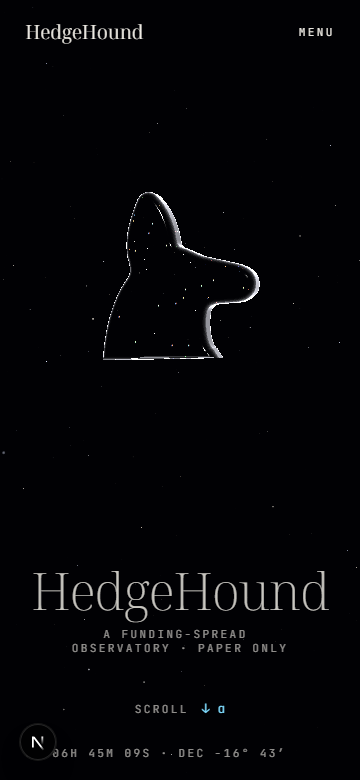
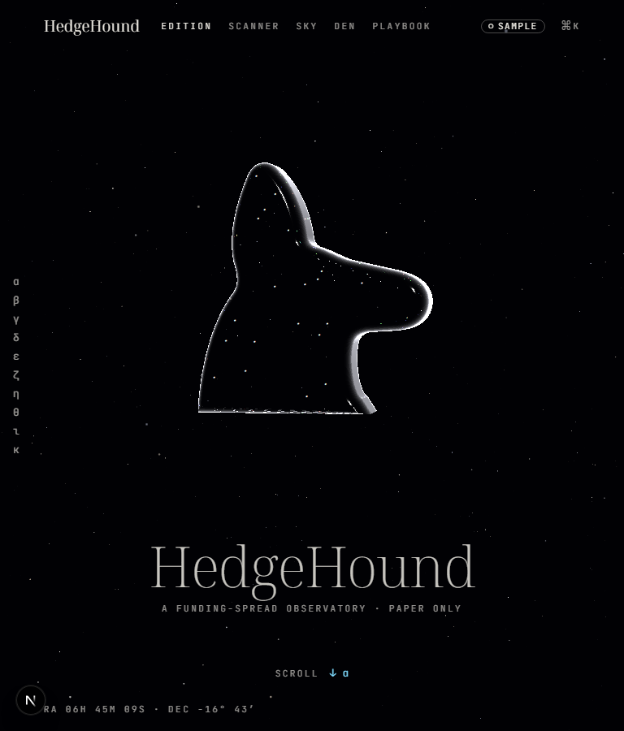
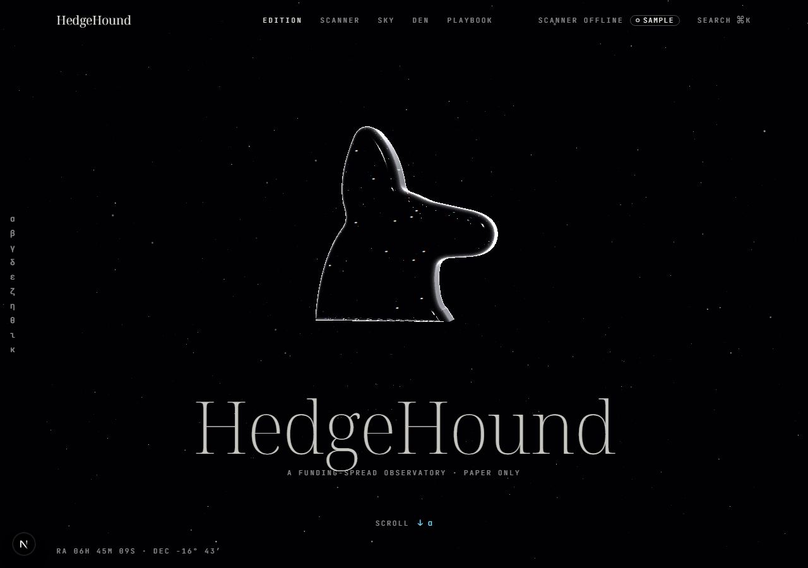

# Dokumen Teknis Modul 2 — HTML Semantik, Tailwind CSS, dan Aksesibilitas

Nama/NIM   : Ataqah Ramadhan Widiyana Putra / 105224022
Repositori : https://github.com/tokyokoolkar-sys/HedgeHound

## 1. Struktur Semantik

Halaman utama (`/`) dibangun dari landmark HTML, bukan `div` bersarang. Tabel di
bawah diukur dari DOM hasil render di `http://localhost:8080/`, bukan dari kode
sumber.

| Peran aksesibilitas | Elemen | Label aksesibel |
|---|---|---|
| banner | `header` | — |
| navigation | `nav` | `Pages` |
| main | `main` | — |
| navigation | `nav` | `Chapters` |
| region | `section` (14 buah) | satu per bab: Overture, α … κ |
| contentinfo | `footer` | `Ledger` |
| navigation | `nav` | `Footer` |

Hierarki judul: tepat satu `h1` ("HedgeHound") untuk nama produk. Setiap bab
memakai `h2` ("α Canis Major: The hound in the sky", "β Sniff: Sniff", …) dan
subbagian memakai `h3` ("What the scanner checks"). Tidak ada lompatan tingkat
(tidak ada `h2` langsung diikuti `h4`).

Pohon aksesibilitas halaman utama, dihasilkan dari DOM ter-render:

```
banner
├── navigation "Pages"
└── navigation "Chapters"
main
└── region × 14   (satu section per bab)
footer "Ledger"
└── navigation "Footer"
```

Pohon ini diambil dengan membaca DOM ter-render (`querySelectorAll` pada elemen
landmark dan atribut `aria-label`), karena panel Accessibility di DevTools tidak
dapat ditangkap layarnya dari lingkungan otomatis. Tangkapan layar panel DevTools
dapat dilampirkan manual tanpa mengubah isi tabel di atas.

## 2. Tata Letak Responsif

Tangkapan layar halaman utama pada tiga lebar yang diminta:

| 360 px | 768 px | 1280 px |
|---|---|---|
|  |  |  |

Perbedaan yang terlihat:

- **360 px** — navigasi utama runtuh menjadi satu tombol `MENU`, tidak ada rel
  bab di sisi kiri, judul turun ke bawah kanvas. Tidak ada gulir horizontal.
- **768 px** — kanvas dan judul mengisi lebar penuh, tombol `MENU` masih dipakai.
- **1280 px** — navigasi penuh (`EDITION SCANNER SKY DEN PLAYBOOK`), lencana
  `SAMPLE`, kolom pencarian `⌘K`, dan rel bab α–κ di sisi kiri tampil.

Kelas Tailwind dan alasannya:

| Kelas | Berkas | Alasan |
|---|---|---|
| `hidden lg:block`, `hidden xl:block`, `hidden hd:block` | `src/components/scanner/scanner-page.tsx:360` | Kolom tabel pemindai bertambah hanya bila lebar cukup. Kolom tambahan disembunyikan di bawah ambangnya, bukan diperkecil, supaya angka funding tetap terbaca. |
| `hidden xl:flex`, `hidden hd:flex` | `src/components/scanner/scanner-page.tsx:249` | Sama untuk header kolom, agar header dan sel hilang bersamaan (tidak ada kolom tanpa judul). |
| breakpoint `hd` = `90rem` | `src/styles.css:61` (`--breakpoint-hd: 90rem`) | Tailwind baku berhenti di `2xl` (96rem). Proyek butuh satu ambang di 1440 px, jadi ditambahkan breakpoint kustom `hd` di `@theme`. |
| `flex` | header, rel bab, baris tabel | Untuk deretan satu dimensi (baris data, daftar tautan). |
| `grid` | atlas koin dan tata letak bagian | Untuk penempatan dua dimensi yang perlu sejajar antar baris. |
| `min-h-svh`, satuan `dvh` | `src/app/loading.tsx`, halaman | Tinggi viewport dinamis: bilah alamat seluler menyusut tanpa memotong kanvas, berbeda dengan `100vh` yang tetap. |
| `px-[max(16px,7vw)]` | `error.tsx`, `not-found.tsx`, `loading.tsx` | Padding tepi mengikuti lebar layar tetapi tidak pernah di bawah 16 px, sehingga teks tidak menempel di layar sempit. |

Pendekatan yang dipakai adalah *mobile-first*: gaya dasar untuk layar sempit,
lalu varian `sm:`, `md:`, `lg:`, `xl:`, dan `hd:` menambah tata letak saat ruang
tersedia.

## 3. Audit Aksesibilitas

### 3.1 Lighthouse (kategori Accessibility, halaman utama)

| Tahap | Skor | Audit gagal |
|---|---|---|
| Audit pertama (sebelum perbaikan) | 100 | 0 |
| Audit akhir (sesudah perbaikan) | 100 | 0 |

Perintah: `npx lighthouse http://localhost:8080/ --only-categories=accessibility`.

Catatan jujur: audit pertama sudah tidak menemukan pelanggaran, sehingga tidak ada
perbaikan aksesibilitas yang dapat dicatat sebagai "sesudah". Kolom "sebelum"
diisi dengan hasil audit pertama yang sebenarnya, bukan angka rendah yang dibuat.
Yang masih di bawah ambang di proyek ini adalah **performa seluler**, bukan
aksesibilitas (lihat bagian 4).

### 3.2 axe-core

axe-core 4.10.2 dijalankan pada DOM ter-render dengan tag `wcag2a`, `wcag2aa`,
`wcag21a`, `wcag21aa`, dan `best-practice`.

| Hasil | Jumlah |
|---|---|
| Pelanggaran (violations) | 0 |
| Pemeriksaan lolos (passes) | 37 |
| Audit gagal yang perlu diperbaiki | tidak ada |

### 3.3 Pemeriksaan manual dengan papan ketik

Dua belas penekanan `Tab` pertama dari kondisi tanpa fokus. Kolom "cincin fokus"
diukur dari `outline-style`/`outline-width` elemen yang sedang fokus.

| # | Elemen | Teks | Cincin fokus terlihat |
|---|---|---|---|
| 1 | `a` | SKIP TO CONTENT | ya |
| 2 | `a` | HedgeHound | ya |
| 3 | `a` | EDITION | ya |
| 4 | `a` | SCANNER | ya |
| 5 | `a` | SKY | ya |
| 6 | `a` | DEN | ya |
| 7 | `a` | PLAYBOOK | ya |
| 8 | `button` | SEARCH ⌘K | ya |
| 9 | `a` | α | ya |
| 10 | `a` | β | ya |
| 11 | `a` | γ | ya |
| 12 | `a` | δ | ya |

Urutan fokus mengikuti urutan visual dan dimulai dari tautan lewati-ke-konten,
sehingga pengguna papan ketik tidak perlu melewati seluruh navigasi untuk mencapai
isi. Seluruh dua belas elemen menampilkan cincin fokus; tidak ada elemen yang
menerima fokus tanpa indikator.

## 4. Kendala dan Penyelesaian

1. **Tangkapan layar kanvas WebGL tidak stabil.** Halaman utama memakai animasi
   berbasis scroll dan `requestAnimationFrame`, sehingga tangkapan layar otomatis
   bisa menangkap frame setengah jadi. Penyelesaian: emulasi
   `prefers-reduced-motion: reduce`, tunggu `networkidle`, lalu jeda 1,2 detik
   sebelum menangkap. Ketiga tangkapan pada bagian 2 dihasilkan dengan cara ini.
2. **Kolom funding tambahan tidak muat di bawah 1440 px.** Tailwind baku tidak
   punya ambang di 1440 px. Penyelesaian: breakpoint kustom `hd` = `90rem` di
   `@theme`; kolom disembunyikan (`hidden hd:block`) alih-alih diperkecil.
3. **Panel Accessibility DevTools tidak dapat diotomasi.** Penyelesaian: pohon
   aksesibilitas disusun dari DOM ter-render (bagian 1) dan dilengkapi tangkapan
   layar manual bila diperlukan.
4. **Judul bab dekoratif.** Dua elemen `h2` pada bab transisi tidak memiliki teks
   yang terbaca. axe tidak melaporkannya sebagai pelanggaran, tetapi ini dicatat
   sebagai sisa perbaikan: sebaiknya dijadikan `aria-hidden` atau diberi teks
   tersembunyi yang bermakna.
5. **Performa seluler** masih di bawah 85 pada Lighthouse kategori Performance
   akibat hidrasi dan three.js. Ini di luar cakupan aksesibilitas modul ini dan
   masih berjalan (lihat `docs/redesign/TICKETS.md`).

## 5. Catatan Pemanfaatan AI

- **Alat:** Command Code (CLI agent, model Claude).
- **Perintah utama:**
  - `npm run dev` — menjalankan server lokal di `http://localhost:8080`.
  - `node capture.js` — Playwright: tangkapan layar 360/768/1280 px, pemindaian
    landmark dan hierarki judul, penyuntikan axe-core 4.10.2, dan 12 langkah
    `Tab`.
  - `npx lighthouse http://localhost:8080/ --only-categories=accessibility`.
- **Bagian yang dihasilkan AI:** seluruh angka pada bagian 1 dan 3 (jumlah
  landmark, hierarki judul, skor Lighthouse, hasil axe, urutan fokus) dan
  tangkapan layar pada bagian 2.
- **Bagian yang diperiksa manusia:** ketiga tangkapan layar dibuka dan dicocokkan
  dengan deskripsi pada bagian 2 (navigasi runtuh di 360 px, rel bab muncul di
  1280 px). Penjelasan keputusan teknis pada bagian 2 ditulis ulang agar sesuai
  dengan alasan sebenarnya di repo.
- **Cara verifikasi:** setiap angka dapat dijalankan ulang dengan tiga perintah di
  atas. Tidak ada nilai yang diisi manual.
