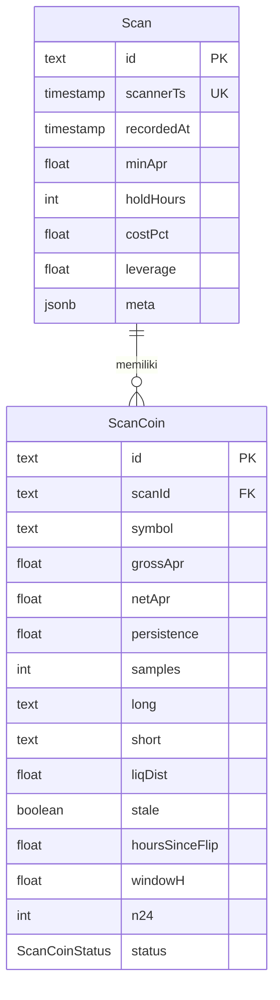

# Dokumen Teknis Modul 6 — PostgreSQL dan Prisma ORM

Nama/NIM   : Ataqah Ramadhan Widiyana Putra / 105224022
Repositori : https://github.com/tokyokoolkar-sys/HedgeHound

## 1. Rancangan Data

Modul ini memakai dua entitas inti produk: **`Scan`** (satu hasil polling pemindai) dan **`ScanCoin`** (satu baris koin di dalam hasil polling tersebut). Keduanya adalah data yang benar-benar ditulis aplikasi setiap menit oleh `src/lib/scan/record-job.ts`, bukan tabel contoh.



**Relasi.** `Scan 1 — N ScanCoin` lewat `ScanCoin.scanId → Scan.id`. Satu scan tidak mungkin ada tanpa koin, dan satu baris koin tidak bermakna tanpa scan induknya.

**Kunci dan constraint unik.**

| Constraint | Alasan |
|---|---|
| `Scan.id` (PK) | Identitas baris; dipakai sebagai foreign key anak. |
| `Scan.scannerTs` (UNIQUE) | Satu waktu polling hanya boleh tercatat sekali. Ini kunci idempotensi perekaman: polling ulang pada detik yang sama tidak membuat baris ganda. |
| `ScanCoin.id` (PK) | Identitas baris koin. |
| `ScanCoin(scanId, symbol)` (UNIQUE) | Dalam satu scan, satu simbol hanya boleh muncul sekali. Ini juga kunci `upsert` pada seed. |
| `ScanCoin.symbol` (INDEX) | Mempercepat riwayat per koin (`/sky`, analisis historis), tanpa memaksa unik karena simbol berulang di banyak scan. |
| `WatchlistItem.symbol` (UNIQUE) | Satu koin hanya boleh masuk watchlist sekali. |
| `PaperOutcome.ticketId` (UNIQUE) | Satu tiket paper hanya punya satu hasil (relasi 1–1). |

**Alasan pemilihan aturan `onDelete`.**

1. **`ScanCoin.scan` → `onDelete: Cascade`.** `ScanCoin` adalah bagian dari satu snapshot; tanpanya snapshot tidak lengkap dan barisnya tidak dapat dipakai sendiri. Ketika satu scan dihapus (mis. pembersihan data uji atau retensi), menghapus anak-anaknya adalah tindakan yang benar. `Cascade` juga mencegah baris yatim yang akan membuat agregasi riwayat salah. Konsekuensinya, penghapusan induk harus disengaja karena ia ikut menghapus riwayat koin; karena itu operasi semacam ini dijalankan di dalam transaksi bila melibatkan lebih dari satu tabel.
2. **`PaperOutcome.ticket` → `onDelete: Restrict`.** Hasil paper adalah catatan audit (status `open/closed`, `realizedFundingUsd`, `realizedPnlUsd`). Menghapus tiket tidak boleh diam-diam menghapus hasilnya. `Restrict` membuat PostgreSQL menolak penghapusan tiket selama hasilnya masih ada; penghapusan yang benar harus menghapus hasil lebih dulu, dan itu dilakukan dalam satu transaksi. Aturan ini juga memberi bukti galat foreign key yang nyata pada Bagian 5.

FK dan unique index ditegakkan di level PostgreSQL, bukan hanya di Prisma, sehingga tetap berlaku untuk `psql`, seed, dan proses lain.

## 2. Skema dan Migrasi

### 2.1 Isi `prisma/schema.prisma`

```prisma
generator client {
  provider = "prisma-client-js"
}

datasource db {
  provider = "postgresql"
}

model PaperTicket {
  id          String       @id @default(cuid())
  symbol      String
  side        PaperSide
  notionalUsd Float
  leverage    Float
  holdHours   Int
  note        String?
  createdAt   DateTime     @default(now())
  outcome     PaperOutcome?
}

enum PaperSide {
  long
  short
}

model Scan {
  id         String    @id @default(cuid())
  scannerTs  DateTime  @unique
  recordedAt DateTime  @default(now())
  minApr     Float
  holdHours  Int
  costPct    Float
  leverage   Float
  meta       Json
  coins      ScanCoin[]
}

model ScanCoin {
  id                  String          @id @default(cuid())
  scanId              String
  scan                Scan            @relation(fields: [scanId], references: [id], onDelete: Cascade)
  symbol              String
  grossApr            Float
  netApr              Float
  persistence         Float
  samples             Int
  long                String
  short               String
  liqDist             Float
  stale               Boolean
  avgSpreadHr         Float?
  avgAprSigned        Float?
  hoursSinceFlip      Float
  windowH             Float
  n24                 Int
  status              ScanCoinStatus
  lighterHr           Float?
  binanceHr           Float?
  lighterVol24Usd     Float?
  lighterOiUsd        Float?
  binanceVol24Usd     Float?
  binanceOiUsd        Float?

  @@unique([scanId, symbol])
  @@index([symbol])
}

enum ScanCoinStatus {
  ok
  building_history @map("building history")
}

model WatchlistItem {
  id        String   @id @default(cuid())
  symbol    String   @unique
  note      String?
  createdAt DateTime @default(now())
}

model PaperOutcome {
  id                String             @id @default(cuid())
  ticketId          String             @unique
  ticket            PaperTicket        @relation(fields: [ticketId], references: [id], onDelete: Restrict)
  status            PaperOutcomeStatus
  openedAt          DateTime
  closedAt          DateTime?
  realizedFundingUsd Float?
  realizedPnlUsd    Float?
  updatedAt         DateTime           @updatedAt
}

enum PaperOutcomeStatus {
  open
  closed
}
```

### 2.2 Daftar folder `prisma/migrations`

```
prisma/migrations/
├── migration_lock.toml
├── 20261030163924_init/
│   └── migration.sql
├── 20261030170000_scan_history/
│   └── migration.sql
└── 20261105103213_paper_outcome_restrict/
    └── migration.sql
```

Status migrasi aktual:

```
$ npx prisma migrate status
Datasource "db": PostgreSQL database "hedgehound", schema "public" at "127.0.0.1:55433"

3 migrations found in prisma/migrations

Database schema is up to date!
```

Migrasi dasar membuat skema dan enum tiket paper:

```sql
-- 20261030163924_init/migration.sql
CREATE SCHEMA IF NOT EXISTS "public";
CREATE TYPE "PaperSide" AS ENUM ('long', 'short');

CREATE TABLE "PaperTicket" (
    "id" TEXT NOT NULL,
    "symbol" TEXT NOT NULL,
    "side" "PaperSide" NOT NULL,
    "notionalUsd" DOUBLE PRECISION NOT NULL,
    "leverage" DOUBLE PRECISION NOT NULL,
    "holdHours" INTEGER NOT NULL,
    "note" TEXT,
    "createdAt" TIMESTAMP(3) NOT NULL DEFAULT CURRENT_TIMESTAMP,
    CONSTRAINT "PaperTicket_pkey" PRIMARY KEY ("id")
);
```

Migrasi kedua membuat dua entitas inti, unique index, index pencarian, dan FK:

```sql
-- 20261030170000_scan_history/migration.sql (potongan)
CREATE TYPE "ScanCoinStatus" AS ENUM ('ok', 'building history');

CREATE TABLE "Scan" (
    "id" TEXT NOT NULL,
    "scannerTs" TIMESTAMP(3) NOT NULL,
    "recordedAt" TIMESTAMP(3) NOT NULL DEFAULT CURRENT_TIMESTAMP,
    "minApr" DOUBLE PRECISION NOT NULL,
    "holdHours" INTEGER NOT NULL,
    "costPct" DOUBLE PRECISION NOT NULL,
    "leverage" DOUBLE PRECISION NOT NULL,
    "meta" JSONB NOT NULL,
    CONSTRAINT "Scan_pkey" PRIMARY KEY ("id")
);

CREATE TABLE "ScanCoin" (
    "id" TEXT NOT NULL,
    "scanId" TEXT NOT NULL,
    "symbol" TEXT NOT NULL,
    /* kolom metrik: grossApr ... binanceOiUsd */
    CONSTRAINT "ScanCoin_pkey" PRIMARY KEY ("id")
);

CREATE UNIQUE INDEX "Scan_scannerTs_key" ON "Scan"("scannerTs");
CREATE INDEX "ScanCoin_symbol_idx" ON "ScanCoin"("symbol");
CREATE UNIQUE INDEX "ScanCoin_scanId_symbol_key" ON "ScanCoin"("scanId", "symbol");
CREATE UNIQUE INDEX "WatchlistItem_symbol_key" ON "WatchlistItem"("symbol");
CREATE UNIQUE INDEX "PaperOutcome_ticketId_key" ON "PaperOutcome"("ticketId");

ALTER TABLE "ScanCoin" ADD CONSTRAINT "ScanCoin_scanId_fkey"
  FOREIGN KEY ("scanId") REFERENCES "Scan"("id") ON DELETE CASCADE ON UPDATE CASCADE;
```

Migrasi ketiga mengubah aturan hapus hasil paper dari `CASCADE` menjadi `RESTRICT`:

```sql
-- 20261105103213_paper_outcome_restrict/migration.sql
ALTER TABLE "PaperOutcome" DROP CONSTRAINT "PaperOutcome_ticketId_fkey";
ALTER TABLE "PaperOutcome" ADD CONSTRAINT "PaperOutcome_ticketId_fkey"
  FOREIGN KEY ("ticketId") REFERENCES "PaperTicket"("id")
  ON DELETE RESTRICT ON UPDATE CASCADE;
```

### 2.3 Tangkapan layar `\d` dari psql

Keluaran verbatim sesi `psql` (klien PostgreSQL 17, database `hedgehound`). Perintah dijalankan dari Windows karena `psql` tidak ada di `PATH`:

```
> psql -h 127.0.0.1 -p 55433 -U postgres -d hedgehound -c '\d "Scan"' -c '\d "ScanCoin"'
```

```
                                  Table "public.Scan"
   Column   |              Type              | Collation | Nullable |      Default
------------+--------------------------------+-----------+----------+-------------------
 id         | text                           |           | not null |
 scannerTs  | timestamp(3) without time zone |           | not null |
 recordedAt | timestamp(3) without time zone |           | not null | CURRENT_TIMESTAMP
 minApr     | double precision               |           | not null |
 holdHours  | integer                        |           | not null |
 costPct    | double precision               |           | not null |
 leverage   | double precision               |           | not null |
 meta       | jsonb                          |           | not null |
Indexes:
    "Scan_pkey" PRIMARY KEY, btree (id)
    "Scan_scannerTs_key" UNIQUE, btree ("scannerTs")
Referenced by:
    TABLE "ScanCoin" CONSTRAINT "ScanCoin_scanId_fkey" FOREIGN KEY ("scanId") REFERENCES "Scan"(id) ON UPDATE CASCADE ON DELETE CASCADE

                       Table "public.ScanCoin"
     Column      |       Type       | Collation | Nullable | Default
-----------------+------------------+-----------+----------+---------
 id              | text             |           | not null |
 scanId          | text             |           | not null |
 symbol          | text             |           | not null |
 grossApr        | double precision |           | not null |
 netApr          | double precision |           | not null |
 persistence     | double precision |           | not null |
 samples         | integer          |           | not null |
 long            | text             |           | not null |
 short           | text             |           | not null |
 liqDist         | double precision |           | not null |
 stale           | boolean          |           | not null |
 avgSpreadHr     | double precision |           |          |
 avgAprSigned    | double precision |           |          |
 hoursSinceFlip  | double precision |           | not null |
 windowH         | double precision |           | not null |
 n24             | integer          |           | not null |
 status          | "ScanCoinStatus" |           | not null |
 lighterHr       | double precision |           |          |
 binanceHr       | double precision |           |          |
 lighterVol24Usd | double precision |           |          |
 lighterOiUsd    | double precision |           |          |
 binanceVol24Usd | double precision |           |          |
 binanceOiUsd    | double precision |           |          |
Indexes:
    "ScanCoin_pkey" PRIMARY KEY, btree (id)
    "ScanCoin_scanId_symbol_key" UNIQUE, btree ("scanId", symbol)
    "ScanCoin_symbol_idx" btree (symbol)
Foreign-key constraints:
    "ScanCoin_scanId_fkey" FOREIGN KEY ("scanId") REFERENCES "Scan"(id) ON UPDATE CASCADE ON DELETE CASCADE
```

```
                          Table "public.PaperTicket"
   Column    |              Type              | Nullable |      Default
-------------+--------------------------------+----------+-------------------
 id          | text                           | not null |
 symbol      | text                           | not null |
 side        | "PaperSide"                    | not null |
 notionalUsd | double precision               | not null |
 leverage    | double precision               | not null |
 holdHours   | integer                        | not null |
 note        | text                           |          |
 createdAt   | timestamp(3) without time zone | not null | CURRENT_TIMESTAMP
Indexes:
    "PaperTicket_pkey" PRIMARY KEY, btree (id)
Referenced by:
    TABLE "PaperOutcome" CONSTRAINT "PaperOutcome_ticketId_fkey" FOREIGN KEY ("ticketId") REFERENCES "PaperTicket"(id) ON UPDATE CASCADE ON DELETE RESTRICT

                             Table "public.PaperOutcome"
       Column       |              Type              | Nullable | Default
--------------------+--------------------------------+----------+---------
 id                 | text                           | not null |
 ticketId           | text                           | not null |
 status             | "PaperOutcomeStatus"           | not null |
 openedAt           | timestamp(3) without time zone | not null |
 closedAt           | timestamp(3) without time zone |          |
 realizedFundingUsd | double precision               |          |
 realizedPnlUsd     | double precision               |          |
 updatedAt          | timestamp(3) without time zone | not null |
Indexes:
    "PaperOutcome_pkey" PRIMARY KEY, btree (id)
    "PaperOutcome_ticketId_key" UNIQUE, btree ("ticketId")
Foreign-key constraints:
    "PaperOutcome_ticketId_fkey" FOREIGN KEY ("ticketId") REFERENCES "PaperTicket"(id) ON UPDATE CASCADE ON DELETE RESTRICT
```

## 3. Seed dan Prisma Client

Seed ada di `prisma/seed.ts` dan didaftarkan melalui `prisma.config.ts`:

```ts
migrations: {
  path: "prisma/migrations",
  seed: "node --experimental-strip-types prisma/seed.ts",
},
```

### 3.1 Keluaran `npx prisma db seed` dua kali

Jalankan pertama:

```
$ npx prisma db seed
Running seed command `node --experimental-strip-types prisma/seed.ts` ...
seed ok: 2 scans, 7 scan coins, 3 watchlist items

The seed command has been executed.
```

Jalankan kedua:

```
$ npx prisma db seed
Running seed command `node --experimental-strip-types prisma/seed.ts` ...
seed ok: 2 scans, 7 scan coins, 3 watchlist items

The seed command has been executed.
```

Jumlah baris tidak bertambah. Dicek langsung di PostgreSQL:

```
 scans | scan_coins | watchlist
-------+------------+-----------
     2 |          7 |         3
(1 row)

      scannerTs      | coins
---------------------+-------
 2026-01-01 00:00:00 |     3
 2026-01-01 00:05:00 |     4
```

### 3.2 Cara seed dibuat dapat dijalankan ulang

Seed memakai `upsert`, bukan `create`:

```ts
const saved = await prisma.scan.upsert({
  where: { scannerTs: scan.scannerTs },
  update: { minApr, holdHours, costPct, leverage, meta },
  create: { scannerTs, minApr, holdHours, costPct, leverage, meta },
})

await prisma.scanCoin.upsert({
  where: { scanId_symbol: { scanId: saved.id, symbol: c.symbol } },
  update: c,
  create: { ...c, scanId: saved.id },
})
```

- `Scan` memakai kunci unik `scannerTs`, sehingga dua kali seed menghasilkan baris yang sama dan `id` lama dipertahankan.
- `ScanCoin` memakai kunci komposit `scanId_symbol`, sehingga koin yang sama di scan yang sama diperbarui, bukan diduplikasi.
- `WatchlistItem` memakai `symbol` unik dengan `upsert` yang sama.
- Seed tidak memakai `createMany` karena `createMany` tidak melakukan pembaruan; `upsert` adalah bentuk yang tepat untuk data yang harus idempoten.

### 3.3 Alasan seed tidak mengimpor `lib/prisma.ts`

`src/lib/prisma.ts` pada proyek ini adalah `src/lib/db.ts`, dan berkas itu:

1. memakai `import "server-only"` — penanda yang hanya boleh dieksekusi di Server Component/Route Handler Next.js;
2. menyimpan instance di `globalThis` (`globalForPrisma.prisma`) untuk hot reload Next.js, pola yang tidak relevan untuk proses CLI sekali jalan;
3. membuat koneksi saat modul diimpor dan melempar error bila `DATABASE_URL` belum ada.

Proses `prisma db seed` berjalan sebagai Node script mandiri, bukan di dalam server Next.js. Mengimpor modul tersebut akan membawa batas `server-only` dan cache global ke proses CLI. Karena itu `prisma/seed.ts` membuat `PrismaClient` sendiri dengan adapter `PrismaPg`, lalu menutupnya di `finally`:

```ts
const prisma = new PrismaClient({ adapter: new PrismaPg({ connectionString: url }) })
...
main().finally(() => prisma.$disconnect())
```

## 4. Operasi CRUD

CRUD diuji dengan skrip yang memakai jalur Prisma Client yang sama dengan aplikasi: `scripts/prisma/crud.ts` (dijalankan `npm run db:demo:crud`). Perintah ini dapat diulang karena selalu membersihkan data demo di awal.

| Entitas | Aksi / berkas | Metode Prisma | Galat yang ditangani |
|---|---|---|---|
| `Scan` + `ScanCoin` | Create bertingkat — `scripts/prisma/crud.ts`; jalur produksi `src/lib/scan/record-job.ts` | `scan.create({ data: { coins: { create: [...] } } })` | `P2002` bila `scannerTs` sudah ada; di record-job diabaikan sebagai no-op |
| `Scan` | Read — `scripts/prisma/crud.ts` | `scan.findUnique({ where: { id }, include: { coins: true } })` | `null` bila tidak ada |
| `ScanCoin` | Update — `scripts/prisma/crud.ts` | `scanCoin.update({ where: { id }, data: { netApr } })` | `P2025` bila baris tidak ada |
| `ScanCoin` | Delete — `scripts/prisma/crud.ts` | `scanCoin.delete({ where: { id } })` | `P2025` bila baris sudah dihapus |
| `Scan` | Delete induk — `scripts/prisma/crud.ts` | `scan.delete({ where: { id } })` | `P2025`; anak dihapus lewat `Cascade` |
| `WatchlistItem` | Create — `scripts/prisma/crud.ts` | `watchlistItem.create({ data: { symbol } })` | `P2002` karena `symbol` unik |
| `PaperTicket` / `PaperOutcome` | Delete berurutan — `scripts/prisma/transaction.ts` | `paperOutcome.delete` lalu `paperTicket.delete` | `P2003` bila urutan salah (`Restrict`) |

Catatan jujur mengenai "formulir": pada Phase 0 aplikasi ini **tidak memiliki formulir yang menulis ke basis data**. Halaman `/den` menyimpan buku paper di browser (`localStorage`), sedangkan `/scanner` dan `/sky` hanya membaca API pemindai. Satu-satunya penulis ke PostgreSQL adalah job latar `record-job`. Karena itu pesan galat di bawah diambil dari eksekusi nyata Prisma Client pada skrip server, yaitu teks yang sama yang akan dikembalikan ke handler formulir bila formulir ditambahkan.

### 4.1 `P2002` — unique constraint

Dua baris `WatchlistItem` dengan `symbol` yang sama:

```
== P2002: duplicate WatchlistItem.symbol ==
code=P2002 meta={"driverAdapterError":{"name":"DriverAdapterError","cause":{"originalCode":"23505","originalMessage":"duplicate key value violates unique constraint \"WatchlistItem_symbol_key\"","kind":"UniqueConstraintViolation","constraint":{"index":"WatchlistItem_symbol_key"},"table":"WatchlistItem"}},"modelName":"WatchlistItem"}
message=
Invalid `prisma.watchlistItem.create()` invocation:

Unique constraint failed on the constraint: `WatchlistItem_symbol_key`
```

### 4.2 `P2025` — record yang dituju tidak ada

```
== P2025: update a Scan that does not exist ==
code=P2025 meta={"modelName":"Scan","operation":"an update"}
message=
Invalid `prisma.scan.update()` invocation:

An operation failed because it depends on one or more records that were required but not found. No record was found for an update.

== P2025: delete the same Scan again ==
code=P2025 meta={"modelName":"Scan","operation":"a delete"}
message=
Invalid `prisma.scan.delete()` invocation:

An operation failed because it depends on one or more records that were required but not found. No record was found for a delete.
```

### 4.3 Hasil operasi normal

```
== CREATE Scan + nested ScanCoin ==
Scan cmw3epgdg0000pctzfuxywbfm created with 2 coins: BTC, ETH

== READ Scan by id (include coins) ==
scannerTs=2031-12-31T23:59:00.000Z coins=BTC:39.8 ETH:28.6

== UPDATE ScanCoin netApr ==
BTC netApr 39.8 -> 41.1

== DELETE ScanCoin then DELETE Scan (cascade check) ==
Scan cmw3epgdg0000pctzfuxywbfm deleted; remaining ScanCoin rows for it: 0
```

Pada Prisma 7 dengan driver adapter (`@prisma/adapter-pg`), `meta` untuk `P2002`/`P2003` berisi `driverAdapterError.cause` (kode PostgreSQL `23505`/`23503`), bukan `meta.target` seperti Prisma 6. Kode `P2002`/`P2025`/`P2003` tetap sama, sehingga penanganan di aplikasi tidak bergantung pada bentuk `meta`.

## 5. Transaksi dan Rollback

### 5.1 Galat menghapus tanpa transaksi (`RESTRICT`)

`PaperOutcome.ticketId` memakai `ON DELETE RESTRICT`. Menghapus tiket yang masih punya hasil ditolak oleh PostgreSQL:

```
== RESTRICT: delete PaperTicket while its PaperOutcome exists (no transaction) ==
before: {"scans":2,"coins":7,"tickets":1,"outcomes":1}
code=P2003 meta={"modelName":"PaperTicket","driverAdapterError":{"name":"DriverAdapterError","cause":{"originalCode":"23503","originalMessage":"update or delete on table \"PaperTicket\" violates foreign key constraint \"PaperOutcome_ticketId_fkey\" on table \"PaperOutcome\"","kind":"ForeignKeyConstraintViolation","constraint":{"index":"PaperOutcome_ticketId_fkey"}}}}
message=
Invalid `prisma.paperTicket.delete()` invocation:

Foreign key constraint violated on the constraint: `PaperOutcome_ticketId_fkey`
after failed delete: {"scans":2,"coins":7,"tickets":1,"outcomes":1}
```

Baris `PaperOutcome` tetap ada dan tiket tidak hilang: `before` dan `after failed delete` identik. Penghapusan yang benar dilakukan dengan dua langkah dalam satu transaksi:

```
== Same delete in one transaction (outcome first, then ticket) ==
after transaction: {"scans":2,"coins":7,"tickets":0,"outcomes":0}
```

### 5.2 Bukti rollback sebelum dan sesudah pengujian

Skenario: buat `Scan`, buat satu `ScanCoin`, lalu buat `ScanCoin` kedua dengan `(scanId, symbol)` yang sama sehingga `P2002` terjadi di tengah urutan. Seluruh urutan dibungkus `$transaction`.

```
== ROLLBACK: duplicate ScanCoin inside $transaction ==
before: {"scans":2,"coins":7,"tickets":0,"outcomes":0}
rolled back: code=P2002 meta={"driverAdapterError":{"name":"DriverAdapterError","cause":{"originalCode":"23505","originalMessage":"duplicate key value violates unique constraint \"ScanCoin_scanId_symbol_key\"","kind":"UniqueConstraintViolation","constraint":{"index":"ScanCoin_scanId_symbol_key"},"table":"ScanCoin"}},"modelName":"ScanCoin"}
after rollback: {"scans":2,"coins":7,"tickets":0,"outcomes":0}
```

`before` dan `after rollback` identik: `Scan` yang sempat dibuat ikut dibatalkan, tidak ada baris yatim.

Sebagai pembanding, urutan yang sama **tanpa** transaksi meninggalkan `Scan` yatim:

```
== WITHOUT transaction: the same duplicate leaves an orphan Scan ==
code=P2002
orphan Scan still present: cmw3epl8z0005swtzhjfyk12i, coins=1
```

Bukti `Cascade` pada relasi yang memang memakai `Cascade`:

```
== CASCADE: deleting a Scan removes its ScanCoin rows ==
ScanCoin rows left for deleted Scan: 0
```

**Bentuk transaksi yang dipilih.** `scripts/prisma/transaction.ts` memakai dua bentuk sesuai kebutuhannya:

- `$transaction([...])` (array) untuk hapus hasil lalu tiket: dua operasi independen yang harus berhasil bersama, tanpa saling membutuhkan nilai hasil.
- `$transaction(async (tx) => { ... })` (interaktif) untuk skenario rollback: `ScanCoin` kedua membutuhkan `scan.id` yang baru dibuat, dan kegagalannya harus membatalkan langkah sebelumnya. Callback memungkinkan pengurutan dependen dan pelemparan galat di tengah urutan.

## 6. Skenario Uji

Seluruh skenario dijalankan pada PostgreSQL 17.11 (container, port 55433) dengan database `hedgehound`.

| No | Skenario | Perintah / alat | Hasil aktual | Status |
|---|---|---|---|---|
| 1 | Semua migrasi terpasang | `npx prisma migrate status` | `3 migrations found`, `Database schema is up to date!` | Lulus |
| 2 | Seed pertama mengisi data | `npx prisma db seed` | `2 scans, 7 scan coins, 3 watchlist items` | Lulus |
| 3 | Seed kedua idempoten | `npx prisma db seed` | Jumlah sama: `2 scans, 7 scan coins, 3 watchlist items` | Lulus |
| 4 | `Scan.scannerTs` unik menolak duplikat | `INSERT ... SELECT` via psql | `duplicate key value violates unique constraint "Scan_scannerTs_key"` (23505) | Lulus |
| 5 | `ScanCoin(scanId, symbol)` unik menolak duplikat | `INSERT ... SELECT` via psql | `duplicate key value violates unique constraint "ScanCoin_scanId_symbol_key"` (23505) | Lulus |
| 6 | FK menolak `ScanCoin` tanpa induk | `INSERT` dengan `scanId = 'no-such-scan'` | `violates foreign key constraint "ScanCoin_scanId_fkey"` (23503) | Lulus |
| 7 | `WatchlistItem.symbol` unik | `npm run db:demo:crud` | `P2002` pada `WatchlistItem_symbol_key` | Lulus |
| 8 | Update/delete baris yang tidak ada | `npm run db:demo:crud` | `P2025` untuk `Scan` update dan delete | Lulus |
| 9 | `RESTRICT` menolak hapus tiket berhasil | `npm run db:demo:tx` | `P2003` pada `PaperOutcome_ticketId_fkey`; jumlah baris tidak berubah | Lulus |
| 10 | Rollback transaksi dan `Cascade` | `npm run db:demo:tx` | `before` = `after rollback`; koin anak = 0 setelah induk dihapus | Lulus |

**Persentase kelulusan: 10/10 = 100%.**

## 7. Kendala dan Penyelesaian

1. **`psql` tidak ada di `PATH`.** Perintah `psql` gagal ditemukan dari terminal biasa. Penyelesaian: memanggil binary lengkap `C:\Program Files\PostgreSQL\17\bin\psql.exe` dan mengisi `PGPASSWORD` dari `DATABASE_URL` proyek.
2. **Bentuk `meta` galat berbeda di Prisma 7.** Dengan driver adapter, `P2002`/`P2003` tidak lagi memberi `meta.target`, melainkan `meta.driverAdapterError.cause` berisi kode PostgreSQL asli. Penyelesaian: penanganan memakai `code` (`P2002`, `P2025`, `P2003`) dan tidak bergantung pada `meta.target`; skrip demo mencetak seluruh `meta` agar perilaku terlihat.
3. **Seed tidak boleh memakai `src/lib/db.ts`.** Modul tersebut `server-only`, menyimpan cache di `globalThis`, dan membuat koneksi saat diimpor. Penyelesaian: `prisma/seed.ts` membuat `PrismaClient` + `PrismaPg` sendiri dan menutup koneksi di `finally`.
4. **`createMany` tidak idempoten.** Menjalankan seed dua kali akan gagal atau menduplikasi. Penyelesaian: `upsert` pada kunci unik `scannerTs` dan komposit `scanId_symbol`.
5. **Pemilihan `Cascade` vs `Restrict`.** `ScanCoin` wajar ikut terhapus bersama `Scan`, sedangkan `PaperOutcome` adalah audit dan tidak boleh hilang diam-diam. Penyelesaian: `Cascade` untuk `ScanCoin`, `Restrict` untuk `PaperOutcome`, dengan migrasi terpisah `20261105103213_paper_outcome_restrict`.
6. **Job perekam dapat menerima `scannerTs` yang sama.** Pemindai dapat melaporkan waktu polling yang sama saat retry. Penyelesaian: `scannerTs` unik di database, dan `record-job.ts` menelan `P2002` sebagai no-op agar job tidak gagal.
7. **Tidak ada formulir DB di Phase 0.** Halaman `/den` memakai `localStorage` dan halaman lain hanya membaca API pemindai, sehingga CRUD tidak bisa diuji lewat UI. Penyelesaian: disediakan skrip `scripts/prisma/crud.ts` dan `scripts/prisma/transaction.ts` yang memakai Prisma Client yang sama, dapat dijalankan ulang, dan menjadi bukti operasi.
8. **Kredensial dan `.env`.** `prisma.config.ts` memanggil `process.loadEnvFile()` agar `DATABASE_URL` tersedia untuk CLI; `.env` tetap tidak di-commit (`.gitignore`).

## 8. Catatan Pemanfaatan AI

Alat yang digunakan: **Command Code** (agen pengkodean berbasis model Claude) untuk menyusun skrip seed/demo, menjalankan perintah, dan menulis dokumen ini. Skema dan dua migrasi awal sudah ada di repositori sebelum sesi ini; agen memverifikasi dan melengkapinya.

Perintah utama yang dijalankan:

```
npx prisma migrate dev --name paper_outcome_restrict
npx prisma migrate status
npx prisma db seed          # dua kali
npm run db:demo:crud
npm run db:demo:tx
npm run typecheck
npm run lint
psql -h 127.0.0.1 -p 55433 -U postgres -d hedgehound -c '\d "Scan"'
```

Bagian yang dibantu AI:
- `prisma/seed.ts` (baru): seed idempoten dengan `upsert`.
- `scripts/prisma/crud.ts` dan `scripts/prisma/transaction.ts` (baru): bukti CRUD, `P2002`, `P2025`, `P2003`, rollback, dan `Cascade`.
- `prisma/schema.prisma` dan migrasi `20261105103213_paper_outcome_restrict`: mengubah `onDelete` `PaperOutcome.ticket` menjadi `Restrict`.
- `prisma.config.ts` dan `package.json`: pendaftaran seed dan skrip demo.
- Dokumen ini.

Cara verifikasi yang dilakukan:
1. Menjalankan `npx prisma migrate status` dan memastikan tiga migrasi terpasang.
2. Menjalankan `npx prisma db seed` dua kali dan membandingkan keluaran serta `SELECT count(*)` di psql (`2/7/3` tidak berubah).
3. Menjalankan `npm run db:demo:crud` dan `npm run db:demo:tx`, lalu mencocokkan kode galat dengan dokumentasi Prisma (`P2002`, `P2025`, `P2003`).
4. Memeriksa indeks dan foreign key lewat `\d` di psql, termasuk `ON DELETE CASCADE` dan `ON DELETE RESTRICT`.
5. Menjalankan `npm run typecheck` dan `npm run lint`; keduanya keluar tanpa error.
