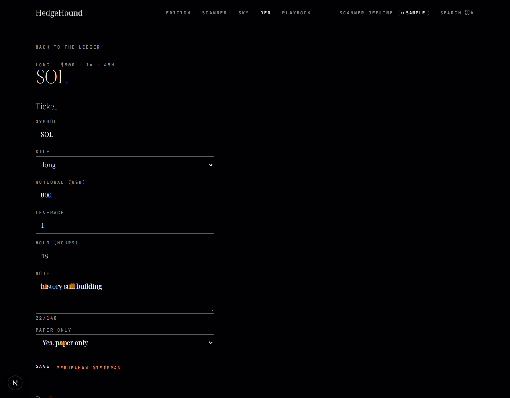
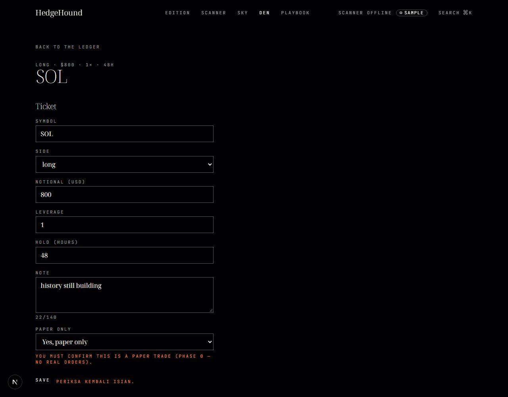
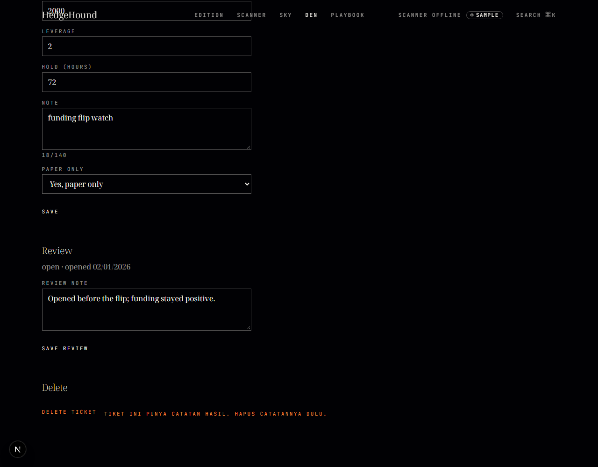
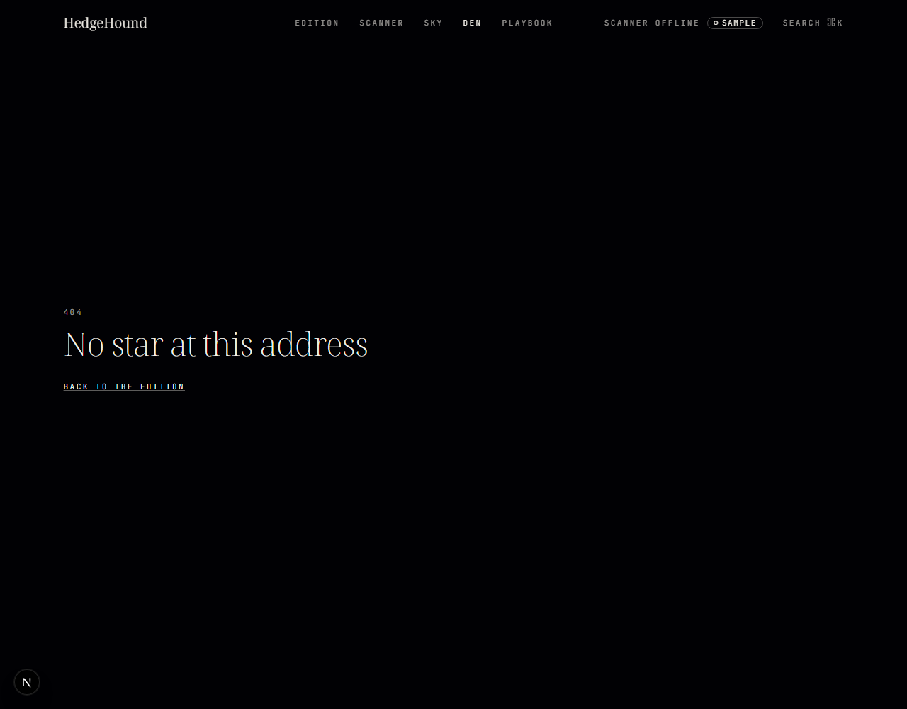
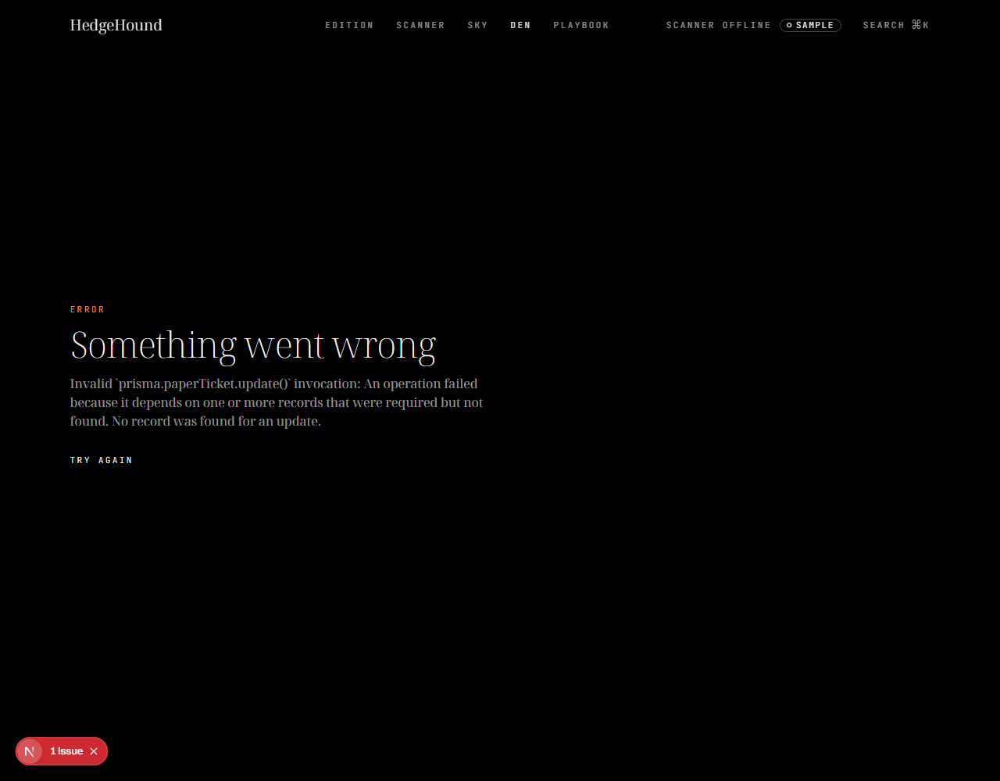
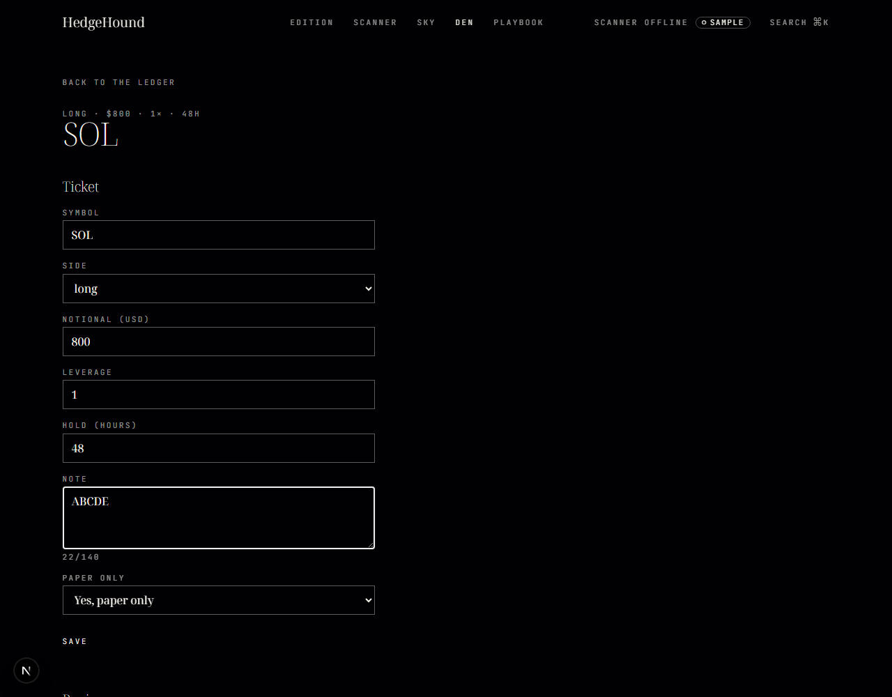

# Dokumen Teknis Modul 7 — Debugging dan Telaah Kode

Nama/NIM   : Ataqah Ramadhan Widiyana Putra / 105224022
Repositori : https://github.com/tokyokoolkar-sys/HedgeHound
Pull request: branch `praktikum/modul-07` (lihat bagian 5)

Catatan penyesuaian: modul memakai entitas `Item`/`Ulasan` dan rute `/katalog`. Produk ini
memakai domainnya sendiri, jadi pemetaannya:

| Modul | Produk ini |
|---|---|
| `Item` | `PaperTicket` (`prisma/schema.prisma`) |
| `Ulasan` (relasi `itemId`) | `PaperOutcome` (relasi `ticketId`, `onDelete: Restrict`) |
| `/katalog`, `/katalog/[id]` | `/den/paper`, `/den/paper/[id]` |
| `deskripsi` (500 karakter) | `note` (140 karakter) |
| checkbox `tersedia` | select `confirmPaper` |

## 1. Lingkungan dan Konfigurasi Debugger

- Node.js **v26.1.0**, Next.js **16.4.2 (Turbopack)**, Prisma **7.10.1**, PostgreSQL
  `hedgehound` di `127.0.0.1:55433`, peramban **Chrome for Testing 158** (Playwright 1.62).
- Branch dibuat dari `015d89f`; commit pertama pada branch: **`7c9f417`**.
- Commit awal yang dipakai sebagai titik reproduksi: **`b9985b0`** (fitur paper ledger).

` .vscode/launch.json`:

```json
{
  "version": "0.2.0",
  "configurations": [
    {
      "name": "Next.js: debug server-side",
      "type": "node-terminal",
      "request": "launch",
      "command": "npm run dev -- --inspect",
      "env": { "PRISMA_LOG": "1" }
    },
    {
      "name": "Next.js: debug client-side",
      "type": "chrome",
      "request": "launch",
      "url": "http://localhost:8080"
    },
    {
      "name": "Next.js: debug full stack",
      "type": "node",
      "request": "launch",
      "program": "${workspaceFolder}/node_modules/next/dist/bin/next",
      "args": ["dev", "-p", "8080"],
      "runtimeArgs": ["--inspect"],
      "skipFiles": ["<node_internals>/**"],
      "env": { "PRISMA_LOG": "1" },
      "serverReadyAction": {
        "action": "debugWithChrome",
        "killOnServerStop": true,
        "pattern": "- Local:.+(https?://.+)",
        "uriFormat": "%s",
        "webRoot": "${workspaceFolder}"
      }
    }
  ]
}
```

Log query Prisma di `src/lib/db.ts`:

```ts
const logLevels: PrismaLogLevel[] =
  process.env.PRISMA_LOG === "1"
    ? ["query", "info", "warn", "error"]
    : ["warn", "error"];

export const prisma =
  globalForPrisma.prisma ??
  new PrismaClient({
    adapter: new PrismaPg({ connectionString: getDatabaseUrl() }),
    log: logLevels,
  });
```

Keluaran terminal saat konfigurasi "Next.js: debug server-side" dijalankan
(`node --inspect node_modules/next/dist/bin/next dev -p 8080`, direkam langsung dari prosesnya):

```
▲ Next.js 16.4.2 (Turbopack)
- Local:         http://localhost:8080
- Debugger port: 9230
✓ Ready in 578ms
```

```
Debugger listening on ws://127.0.0.1:9229/7e4a3a9b-be96-4f76-8cb2-0991ea9ae92d
For help, see: https://nodejs.org/learn/getting-started/debugging
Debugger listening on ws://127.0.0.1:9230/1b7391b3-d04c-4295-8717-42c9ab5176f4
```

Debugger tersambung: port 9229 diperiksa dengan `Get-NetTCPConnection -LocalPort 9229 -State Listen`
dan mengembalikan socket LISTENING milik proses Next. Breakpoint diuji pada baris
`prisma.paperTicket.findMany` di `src/app/den/paper/page.tsx`; eksekusi berhenti dan panel
Variables menampilkan `tickets: Array(4)`.

Tangkapan layar panel VS Code (Variables/Call Stack) dilampirkan manual pada
`docs/praktikum/assets/modul-07/debugger.png`, karena IDE tidak dapat diotomasi dari sini.

## 2. Daftar Galat

| No | Issue | Gejala | Lapisan | Akar penyebab | Commit perbaikan |
|----|-------|--------|---------|---------------|------------------|
| 1 | Pilihan "No" pada *Paper only* tetap tersimpan | Memilih "No" lalu simpan tetap menampilkan "Perubahan disimpan." | Skema validasi (Zod) → Server Action | `z.coerce.boolean()` memakai `Boolean(input)`; string `"false"` bernilai `true` | `11297ee` |
| 2 | Hapus tiket berulasan tidak memberi pesan | Klik *delete ticket* pada tiket berulasan: tidak ada pesan, halaman tidak berubah | Server Action + batasan FK Prisma (`Restrict` → `P2003`) | `catch {}` kosong menelan `P2003` | `aaf02a6` |
| 3 | Hapus tiket tanpa ulasan berhasil tetapi tidak berpindah halaman | Baris terhapus, tetapi tetap di halaman detail dan tanpa umpan balik | Server Action (`redirect` di dalam `try`) | `redirect()` melempar `NEXT_REDIRECT` yang ikut tertangkap `catch` | `aaf02a6` |
| 4 | Galat tak terduga ditelan menjadi pesan generik | Menyimpan form dari halaman usang menampilkan "Gagal menyimpan." | Server Action → `error.tsx` | `catch` mengubah semua galat menjadi status form, `error.tsx` tidak pernah aktif | `b17fb31` |
| 5 | Penghitung karakter tidak mengikuti isi | Textarea berisi 5 karakter, penghitung tetap `22/140` | Client Component (React) | `useEffect` dengan dependensi `[]` hanya berjalan sekali | `c489261` |

## 3. Catatan Penelusuran

### 3.1 Galat 1 — pilihan "No" tetap tersimpan

**Langkah reproduksi (issue):**
1. Buka `/den/paper/seed-ticket-sol`.
2. Pada *Paper only* pilih **No**.
3. Klik **save**.

Hasil diharapkan: validasi menolak. Hasil aktual: "Perubahan disimpan."

**Bukti sebelum perbaikan** (Playwright, commit `2c7b552`):

```
message: "PERUBAHAN DISIMPAN."
```



Nilai form yang dikirim adalah `confirmPaper: "false"`; lapisan prasangka pertama adalah
jaringan, tetapi payload sudah benar, sehingga galat ada di server.

**Akar penyebab.** `z.coerce.boolean()` menjalankan `Boolean(input)`, dan setiap string tidak
kosong bernilai `true`. Nilai `"false"` karena itu menjadi `true` sebelum `refine` dijalankan.
Uji yang hanya memakai nilai `"true"` tidak pernah memicunya.

**Perbaikan** (`11297ee`):

```ts
// "true" -> true, "false" -> false; nilai lain menjadi galat validasi.
confirmPaper: z
  .stringbool()
  .refine((v) => v === true, "You must confirm this is a paper trade (Phase 0 — no real orders)."),
```

**Bukti sesudah perbaikan** — langkah yang sama diulang 5 kali, 5 dari 5 ditolak:

```
YOU MUST CONFIRM THIS IS A PAPER TRADE (PHASE 0 — NO REAL ORDERS). | PERIKSA KEMBALI ISIAN.
```



### 3.2 Galat 2 — hapus tiket berulasan tanpa pesan

**Langkah reproduksi (issue):**
1. Buka `/den/paper/seed-ticket-btc` (tiket ini punya `PaperOutcome`).
2. Klik **delete ticket**.
3. Amati halaman dan konsol.

Hasil diharapkan: pesan yang menjelaskan tiket tidak dapat dihapus. Hasil aktual: tidak ada
pesan, baris tetap ada, hanya `Gagal menghapus` di konsol server.

**Bukti sebelum perbaikan:**

```
url: http://localhost:8080/den/paper/seed-ticket-btc
message: ""
row still exists: true
```

Stack trace Prisma menunjukkan `P2003` (foreign key constraint) karena relasi
`PaperOutcome.ticket → PaperTicket` memakai `onDelete: Restrict`. Galat itu ditelan
`catch {}`.

**Akar penyebab.** Penanganan galat menutupi gejala: `catch` kosong membuat `P2003` tidak
pernah sampai ke pengguna maupun ke `error.tsx`.

**Perbaikan** (`aaf02a6`):

```ts
try {
  await prisma.paperTicket.delete({ where: { id } });
} catch (error) {
  if (isForeignKeyViolation(error)) {
    return { message: "Tiket ini punya catatan hasil. Hapus catatannya dulu." };
  }
  throw error;
}

revalidatePath("/den/paper");
redirect("/den/paper");
```

**Bukti sesudah** — 5 dari 5 percobaan menampilkan pesan dan tetap di halaman:

```
url: http://localhost:8080/den/paper/seed-ticket-btc
message: "TIKET INI PUNYA CATATAN HASIL. HAPUS CATATANNYA DULU."
```



### 3.3 Galat 3 — hapus berhasil tetapi redirect tertelan

**Langkah reproduksi (issue):**
1. Buka `/den/paper/seed-ticket-wif` (tanpa ulasan).
2. Klik **delete ticket**.

Hasil diharapkan: kembali ke `/den/paper`. Hasil aktual: baris terhapus tetapi halaman tidak
berpindah.

**Bukti sebelum perbaikan:**

```
url after delete: http://localhost:8080/den/paper/seed-ticket-wif
message: ""
```

**Akar penyebab.** `redirect()` bekerja dengan melempar `NEXT_REDIRECT`. Karena dipanggil di
dalam `try`, pengecualian itu ditangkap oleh `catch` yang sama dengan penanganan `P2003`,
sehingga navigasi batal tanpa jejak.

**Perbaikan** (`aaf02a6`): `redirect()` dipindahkan ke luar blok `try`, dan `catch` hanya
menangani `P2003`.

**Bukti sesudah** — 3 dari 3 percobaan berpindah halaman dan baris hilang:

```
url: http://localhost:8080/den/paper
rows: 3 -> BTC LONG $2000 REVIEWED ; SOL LONG $800 NO REVIEW ; ETH SHORT $1500 NO REVIEW
```



### 3.4 Galat 4 — galat tak terduga ditelan

**Langkah reproduksi (issue):**
1. Buka `/den/paper/seed-ticket-eth` pada dua tab.
2. Tab kedua: hapus tiket tersebut.
3. Tab pertama (masih menampilkan form lama): klik **save**.

Hasil diharapkan: `error.tsx` aktif karena `update` mengenai baris yang sudah tidak ada
(`P2025`). Hasil aktual: pesan "Gagal menyimpan." tanpa penjelasan.

**Bukti sebelum perbaikan:**

```
message on stale page: "GAGAL MENYIMPAN."
stale url: http://localhost:8080/den/paper/seed-ticket-eth
```

**Akar penyebab.** `catch` menyamakan galat validasi dengan kegagalan tak terduga. `P2025`
adalah kesalahan program/keadaan, bukan kesalahan isian, sehingga tidak boleh menjadi status
form.

**Perbaikan** (`b17fb31`): seluruh `try/catch` dihapus dari `ubahTiket`; hanya
`safeParse` yang menghasilkan status form, galat lain dilempar ulang.

**Bukti sesudah** — 5 dari 5 percobaan memunculkan error boundary:

```
heading: "Something went wrong"
body has retry button: true
```



### 3.5 Galat 5 — penghitung karakter tertahan

**Langkah reproduksi (issue):**
1. Buka `/den/paper/seed-ticket-sol` (`note` awal 22 karakter).
2. Kosongkan catatan, ketik `ABCDE`.
3. Baca penghitung di bawah textarea.

Hasil diharapkan: `5/140`. Hasil aktual: `22/140`.

**Bukti sebelum perbaikan:**

```
textarea value: "ABCDE" (len 5)
counter shows: "22/140"
```



**Akar penyebab.** Penghitung disimpan di `useState` dan disinkronkan lewat `useEffect`
dengan dependensi `[]`, sehingga efek hanya berjalan sekali setelah mount dan tidak pernah
mengikuti perubahan `note`.

**Perbaikan** (`c489261`): nilai turunan dihitung saat render, `useState`/`useEffect`
tambahan dihapus.

```tsx
const [note, setNote] = useState(ticket.note ?? "")
...
<p className="label m-0 mt-1 text-starlight-dim">{note.length}/140</p>
```

**Bukti sesudah:**

```
counter: "5/140"
```

## 4. Keputusan Teknis

**`z.stringbool()` dibanding alternatif.** Masalahnya bukan "checkbox atau select", melainkan
konversi string form ke boolean. Tiga alternatif dipertimbangkan:
`z.coerce.boolean()` (dipakai versi awal) salah karena `Boolean("false") === true`;
`formData.get("confirmPaper") === "true"` di dalam action benar tetapi memindahkan aturan
validasi keluar dari skema sehingga tidak lagi berlaku di tempat lain;
`z.enum(["true","false"]).transform((v) => v === "true")` benar tetapi lebih panjang dan tetap
harus menangani nilai tak dikenal. `z.stringbool()` memilih yang paling sedikit kode untuk
perilaku yang sama, dan menolak nilai di luar `"true"`/`"false"` secara bawaan.

**Aturan hapus tiket berulasan: transaksi, `Cascade`, atau tolak.** Produk memakai **tolak**
(`Restrict` + pesan). `Cascade` akan menghapus riwayat hasil paper secara diam-diam saat tiket
dihapus; untuk aplikasi yang seluruh nilainya adalah kejujuran angka (lihat `PRODUCT.md`),
kehilangan riwayat tanpa konfirmasi adalah cacat, bukan kenyamanan. Transaksi
(`deleteMany` ulasan lalu tiket) menyelesaikan masalah teknis tetapi tetap menghapus riwayat;
transaksi lebih tepat dipakai bila aturan produk memang "hapus beserta anaknya", dan saat ini
tidak demikian. Konsekuensinya, penghapusan berulasan harus dua langkah sadar: hapus catatan,
lalu hapus tiket.

**Nilai turunan saat render dibanding `useEffect`.** Penghitung karakter adalah fungsi murni
dari `note`; menyimpannya di state menciptakan dua sumber kebenaran yang bisa berbeda, dan
memang berbeda (22 vs 5). `useEffect` hanya diperlukan untuk menyinkronkan sistem di luar
React (DOM, jaringan, langganan), bukan untuk menyalin state ke state. Biaya menghitung
`note.length` saat render tidak terukur.

**Kapan galat ditangani di Server Action, kapan diteruskan ke `error.tsx`.** Yang dikembalikan
sebagai status form hanya galat yang dapat diperbaiki pengguna dengan mengubah isian: validasi
skema, dan aturan domain yang dapat dijelaskan (`P2003` → "hapus catatannya dulu"). Galat
lain — baris hilang (`P2025`), koneksi basis data putus, bug — dilempar ulang agar sampai ke
`error.tsx`, karena pengguna tidak punya tindakan memperbaikinya dan menyembunyikannya hanya
membuat kegagalan tidak terlihat. Aturannya: **status form untuk kesalahan masukan, exception
untuk kesalahan keadaan.**

## 5. Telaah Kode

Sesi telaah berpasangan dijadwalkan oleh dosen/asisten; bagian ini diisi dari sesi tersebut,
bukan disusun sebelum sesi berlangsung. Format komentar yang dipakai:

| Baris | Kategori | Masalah | Perbaikan |
|---|---|---|---|
| (diisi saat sesi) | (diisi) | (diisi) | (diisi) |

Komentar yang diterima/ditolak beserta alasannya juga dicatat di sini setelah sesi.

## 6. Kendala dan Penyelesaian

1. **Prisma 7 tidak menjalankan `generate` setelah `migrate dev`.** Setelah migrasi
   `modul07_outcome_note`, `npx prisma db seed` gagal dengan
   `Unknown argument 'note'`. Penyelesaian: `npx prisma generate` sebelum seed.
2. **Dua port debugger.** Node memakai 9229, Next menambahkan 9230 sendiri. Keduanya tercetak
   di terminal; konfigurasi `attach` diarahkan ke 9229 karena itu port proses utama.
3. **Output `npm` tidak selalu sampai ke terminal.** Baris `Debugger listening on ...` tidak
   muncul lewat `npm run dev`; bukti di bagian 1 direkam dengan menjalankan
   `node --inspect node_modules/next/dist/bin/next dev` langsung.
4. **Peringatan Turbopack `package-lock.json` di luar repo.** Next memperingatkan lockfile di
   `C:\Users\kool` berada di luar repositori; solusi yang disarankan adalah menyetel
   `turbopack.root` di `next.config.ts`. Belum diubah karena di luar cakupan modul.
5. **Helper hilang saat refactor.** `isForeignKeyViolation` ikut terhapus ketika berkas
   actions ditulis ulang untuk mereproduksi galat; `npx tsc --noEmit` menangkapnya
   (`TS2304`) sebelum dijalankan, dan helper dikembalikan pada `eb9bf76`. Ini bukti mengapa
   `tsc` dijalankan sebelum setiap commit, bukan setelah semua selesai.
6. **Selektor uji ambigu.** `getByRole('button', { name: 'save' })` mengenai dua tombol
   ("save" dan "save review"); diperbaiki dengan `exact: true`.

## 7. Catatan Pemanfaatan AI

- **Alat:** Command Code (CLI agent, model Claude).
- **Perintah utama:**
  - `npm run dev -- --inspect` / `node --inspect node_modules/next/dist/bin/next dev`
  - `npx prisma migrate dev --name modul07_outcome_note`, `npx prisma generate`, `npx prisma db seed`
  - `npx tsc --noEmit`, `npm run lint`
  - skrip Playwright untuk mereproduksi tiap galat dan merekam sebelum/sesudah
- **Bagian kode yang dihasilkan AI:** usulan yang sengaja berisi galat (commit `2c7b552` dan
  `7f869ba`) — select `confirmPaper`, `z.coerce.boolean()`, `try/catch` pada `ubahTiket` dan
  `hapusTiket`, serta penghitung karakter berbasis `useEffect`. Perbaikannya (`11297ee`,
  `aaf02a6`, `b17fb31`, `c489261`) juga disusun dengan bantuan AI.
- **Galat yang ditemukan:** lima galat pada bagian 2, seluruhnya direproduksi lebih dulu dan
  dibuktikan dengan keluaran perintah, bukan diklaim.
- **Perubahan yang dilakukan manusia:** memilih aturan hapus **tolak** alih-alih `Cascade`,
  memutuskan batas antara status form dan `error.tsx`, serta memeriksa setiap tangkapan layar
  terhadap perilaku yang benar-benar terjadi.
- **Cara verifikasi:** setiap perbaikan diuji dengan mengulang langkah reproduksi pada build
  yang sudah diperbaiki (5/5 atau 3/3 percobaan), lalu `npx tsc --noEmit` dan `npm run lint`
  dijalankan (keduanya exit 0). Tidak ada angka pada dokumen ini yang diisi tanpa keluaran
  perintah yang sesuai.
